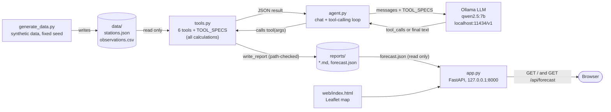

# Marine Weather Agent

A learning project: an AI agent built from scratch, with no agent frameworks.

Four weather stations on the real coast of Kiel Bay (Baltic Sea), NORTH, EAST, SOUTH and WEST,
surround a point in open water. Their weather data is synthetic. The agent forecasts the next
3 days at the sea point, saves a Markdown report, and shows the result on an interactive map.
Along the way it has to notice that station EAST has a broken sensor and leave it out.

**Python tools do all the calculations.** The local LLM (`qwen2.5:7b` via Ollama) only decides
which tool to call next and writes the final report from the tools' results.

## How to run

You need Python 3.10+ and [Ollama](https://ollama.com).

```bash
# 1. Python environment
python3 -m venv .venv && source .venv/bin/activate
pip install -r requirements.txt

# 2. Local LLM (Ollama must be running: `ollama serve`, or the desktop app)
ollama pull qwen2.5:7b

# 3. Create the synthetic data (fixed seed, same data every time)
python generate_data.py

# 4. Optional: call every tool once, without the LLM
python test_tools.py

# 5. Run the agent
python agent.py
cat reports/forecast_report.md

# 6. Show the forecast map
python app.py
# then open http://127.0.0.1:8000 in your browser (Ctrl+C stops the server)
```

The agent prints a trace of each step (which tool it chose, the arguments, a shortened result)
and saves the report to `reports/forecast_report.md`, plus the map data in `reports/forecast.json`.
A run takes about 20–60 seconds on a local GPU.

The map shows the stations (green = OK, red = SUSPECT; click one for details), the sea point with
the 3-day forecast and warning badges, and dashed lines weighted by each station's share of the
forecast. It needs an internet connection for the map tiles and the Leaflet library. The server
only listens on localhost.

## Files

| File | Purpose |
|------|---------|
| `generate_data.py` | Writes `data/stations.json` and `data/observations.csv` (30 days, hourly) |
| `tools.py` | The 6 tools (stations, observations, data quality, Holt-Winters forecast, sea-point estimate, write report) and their JSON specs |
| `agent.py` | The agent loop: LLM → tool call → result → LLM … → final answer |
| `test_tools.py` | Calls each tool once and prints the result |
| `app.py` | Small FastAPI server (localhost only): the map page at `/`, the forecast JSON at `/api/forecast` |
| `web/index.html` | The map page: Leaflet + CARTO Dark Matter tiles (OpenStreetMap data, no API key) |
| `experiments.py` | Runs the agent in "break" scenarios with pass/fail checks: `python experiments.py <scenario>` or `python experiments.py all --runs 5` |
| `docs/architecture.md` | Diagrams and build progress |

## Architecture



The LLM never runs code or touches files. It only *asks* for a tool call, and `agent.py` runs
the real Python function and sends the JSON result back. Tools may only read `data/` and write
`reports/`. Important safety rules live in code, not just in the prompt: tools refuse
unreliable stations, the loop won't accept a final answer until a report is saved, and it stops
when a tool keeps failing. See [docs/architecture.md](docs/architecture.md) for the sequence diagram of one run
and the build progress.
