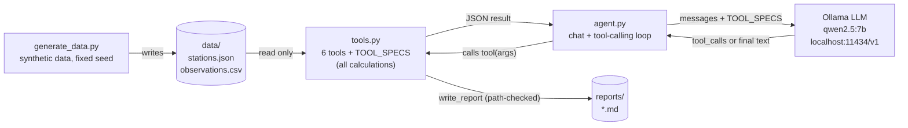

# Marine Weather Agent

A learning project: an AI agent built from scratch, with no agent frameworks.

Four (synthetic) weather stations, NORTH, EAST, SOUTH and WEST, surround a bay. The agent forecasts
the next 3 days at a point in the sea and saves a Markdown report. Along the way it has to
notice that station EAST has a broken sensor and leave it out.

**Python tools do all the calculations.** The local LLM (`qwen2.5:7b` via Ollama) only decides
which tool to call next and writes the final report from the tools' results.

## How to run

You need Python 3.10+ and [Ollama](https://ollama.com).

```bash
# 1. Python environment
python3 -m venv .venv && source .venv/bin/activate
pip install -r requirements.txt

# 2. Local LLM (Ollama must be running: `ollama serve`, or the desktop app)
ollama pull qwen2.5:7b

# 3. Create the synthetic data (fixed seed, same data every time)
python generate_data.py

# 4. Optional: call every tool once, without the LLM
python test_tools.py

# 5. Run the agent
python agent.py
cat reports/forecast_report.md
```

The agent prints a trace of each step (which tool it chose, the arguments, a shortened result)
and saves the report to `reports/forecast_report.md`. A run takes about 30–60 seconds on a local GPU.

## Files

| File | Purpose |
|------|---------|
| `generate_data.py` | Writes `data/stations.json` and `data/observations.csv` (30 days, hourly) |
| `tools.py` | The 6 tools (stations, observations, data quality, Holt-Winters forecast, sea-point estimate, write report) and their JSON specs |
| `agent.py` | The agent loop: LLM → tool call → result → LLM … → final answer |
| `test_tools.py` | Calls each tool once and prints the result |
| `docs/architecture.md` | Diagrams and build progress |

## Architecture



The LLM never runs code or touches files. It only *asks* for a tool call, and `agent.py` runs
the real Python function and sends the JSON result back. Tools may only read `data/` and write
`reports/`. See [docs/architecture.md](docs/architecture.md) for the sequence diagram of one run
and the build progress.
