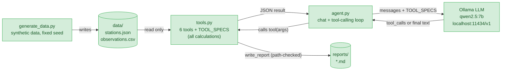
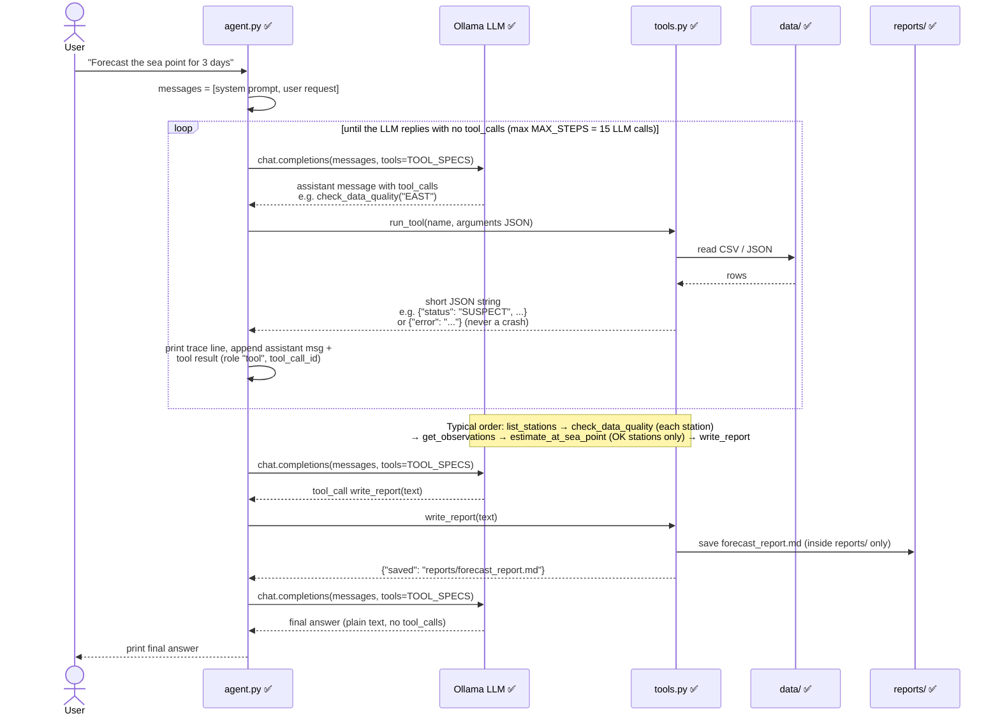

# Architecture

Marine weather agent: four coastal stations around a bay feed a 3-day forecast for one point at sea.
Python tools do every calculation. The local LLM only picks which tools to call and writes the report.

## Progress

| Step | Part | Status |
|------|------|--------|
| 1 | `generate_data.py`: synthetic data in `data/` | ✅ Done |
| 2 | `tools.py`: 6 tools + JSON specs, `test_tools.py` | ✅ Done |
| 3a | `agent.py`: one LLM call, print the raw tool call | ✅ Done |
| 3b | `agent.py`: execute that tool call with `tools.py` | ✅ Done |
| 3c | `agent.py`: full loop, `tool` messages, `MAX_STEPS = 15`, errors go back to the LLM | ✅ Done |
| 3d | `agent.py`: readable trace (tool, args, shortened result) | ✅ Done |
| 3+ | `tools.py`: `estimate_at_sea_point` returns `pressure_trend` + Beaufort `warnings` | ✅ Done |

*Last updated: end of step 3.*

## 1. Components

**Legend:** green = done, grey dashed = not built yet.

Notes:
- The LLM never touches files directly. It writes the report text, and the `write_report` tool saves it.
  So `reports/` is reached only through `tools.py`.
- `tools.py` may only read `data/` and write `reports/`. Paths are checked inside the tools.
- The Ollama model itself isn't part of this repo. It counts as done because `agent.py` now uses it.
- Interpretations such as the pressure trend and wind warnings are worked out in `tools.py`,
  not by the LLM. In an early run the LLM called a rising pressure "falling".

## 2. One agent run (sequence)

**Legend:** ✅ done, ⬜ not built yet.

Unknown tool names, broken argument JSON and bad arguments all come back to the LLM as
`{"error": ...}` tool results, so the model can correct itself. If no final answer comes
after `MAX_STEPS` LLM calls, the run stops with a message.

The key idea: the LLM never runs code. It only *asks* for a tool call. `agent.py` runs the real function
and sends the JSON result back as a `tool` message. The loop repeats until the LLM answers with plain text.
