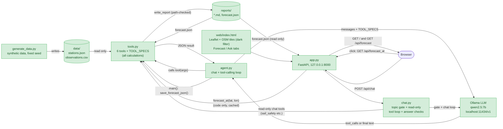
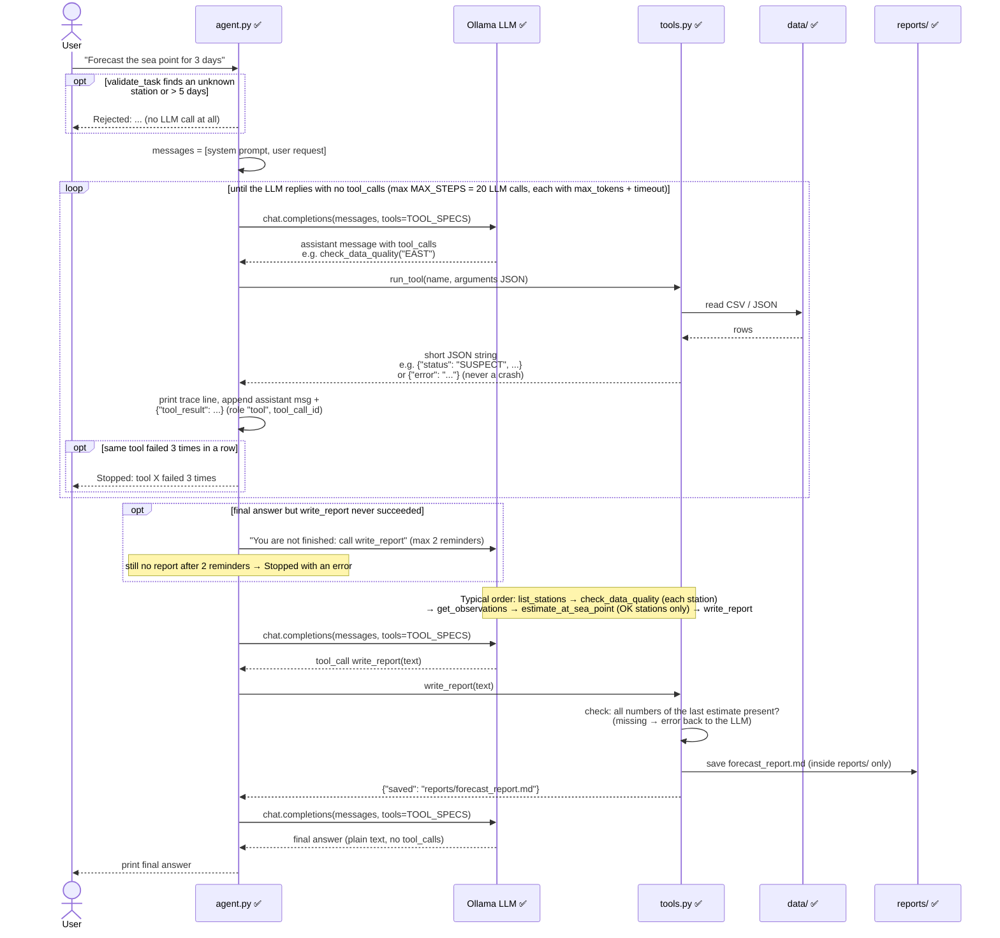
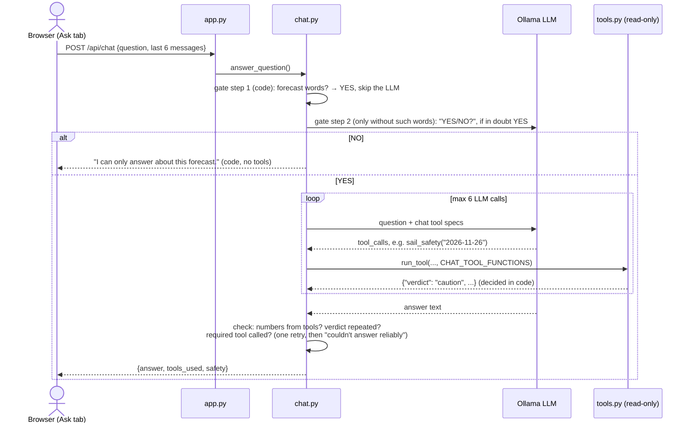
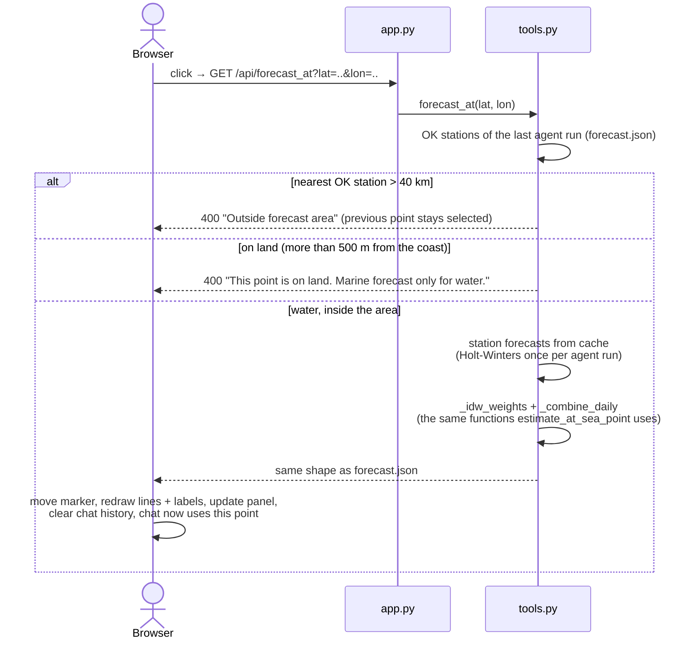

# Architecture

Marine weather agent: four coastal stations around a bay feed a 3-day forecast for one point at sea.
Python tools do every calculation. The local LLM only picks which tools to call and writes the report.

## Progress

| Step | Part | Status |
|------|------|--------|
| 1 | `generate_data.py`: synthetic data in `data/` | ✅ Done |
| 2 | `tools.py`: 6 tools + JSON specs, `test_tools.py` | ✅ Done |
| 3a | `agent.py`: one LLM call, print the raw tool call | ✅ Done |
| 3b | `agent.py`: execute that tool call with `tools.py` | ✅ Done |
| 3c | `agent.py`: full loop, `tool` messages, `MAX_STEPS = 15`, errors go back to the LLM | ✅ Done |
| 3d | `agent.py`: readable trace (tool, args, shortened result) | ✅ Done |
| 3+ | `tools.py`: `estimate_at_sea_point` returns `pressure_trend` + Beaufort `warnings` | ✅ Done |
| 4 | `experiments.py`: 6 "break" scenarios via runtime patching (agent/tools unchanged) | ✅ Done |
| 5 | Guardrails in code: tools refuse SUSPECT stations, error instead of numbers, results wrapped as data, final answer needs a saved report, stop after 3 identical tool failures | ✅ Done |
| 6 | Task validated before the loop; `write_report` checks the report against the last estimate; `experiments.py --runs N` with pass/fail | ✅ Done |
| 7 | `agent.TEMPERATURE` setting; `experiments.py --temperature` | ✅ Done |
| 8 | `MAX_STEPS = 20`; `max_tokens` and a timeout on each LLM call (no silent SDK retries) | ✅ Done |
| 9 | Map: real Kiel Bay coordinates, `reports/forecast.json`, `app.py` (FastAPI, localhost), `web/index.html` (Leaflet) | ✅ Done |
| 10 | Chat panel: `POST /api/chat`, `chat.py` (topic gate, read-only tools, answer checks), `sail_safety` decided in code, `test_chat.py` | ✅ Done |

| 11 | Chat fixes: keyword pre-gate (code), "if in doubt YES", pressure outlook (rising = improving), stricter number check, day mapping; 22 regression questions | ✅ Done |

| 12 | Dynamic forecast point: click → `GET /api/forecast_at` (same weighting as the agent, no LLM, cache per agent run, 40 km limit); chat answers for the selected point; one label per station | ✅ Done |

| 13 | Land/sea check for clicked points: Natural Earth 1:10m land (`download_land.py`), shapely, 500 m coast tolerance, cached; land → 400 "This point is on land" | ✅ Done |

*Last updated: end of step 13 (land/sea check).*

`experiments.py` doesn't change the diagrams. It imports `agent.py`, swaps the task, the system prompt
or entries in `agent.TOOL_FUNCTIONS`, and redirects `write_report` to `reports/experiment_<scenario>.md`.

## 1. Components

**Legend:** green = done, grey dashed = not built yet.

Notes:
- The LLM never touches files directly. It writes the report text, and the `write_report` tool saves it.
  So `reports/` is reached only through `tools.py`.
- `tools.py` may only read `data/` and write `reports/`. Paths are checked inside the tools.
- The Ollama model itself isn't part of this repo. It counts as done because `agent.py` now uses it.
- Interpretations such as the pressure trend and wind warnings are worked out in `tools.py`,
  not by the LLM. In an early run the LLM called a rising pressure "falling".
- `reports/forecast.json` is built by `tools.save_forecast_json()` from tool results only (never LLM text).
  `agent.py` calls it in `main()` after a successful run; experiments never write it.
- The map page calculates nothing; it only displays `/api/forecast`. `app.py` binds to 127.0.0.1 only.
- Stations sit on the real Kiel Bay coast (Marstal, Fehmarn, Schönberger Strand, Damp); the weather data is synthetic.
- The chat only gets read-only tools that read `forecast.json` (no `write_report`). The sailing verdict
  comes from `tools.sail_safety()` (Bft ≤ 4 safe, 5–6 caution, ≥ 7 not safe; falling pressure raises it
  one level). The LLM only explains it.

## 2. One agent run (sequence)

**Legend:** ✅ done, ⬜ not built yet.

### Guardrails (in code, not just in the prompt)

| # | Where | What it does |
|---|-------|--------------|
| 1 | `tools.estimate_at_sea_point` | Checks quality itself and drops SUSPECT stations (`stations_excluded`) |
| 2 | `tools.forecast_station`, `estimate_at_sea_point` | SUSPECT station or none reliable left → `{"error": ...}`, never numbers |
| 3 | `agent.wrap_as_data` + system prompt | Tool output is sent as `{"tool": ..., "tool_result": ...}` and declared to be data |
| 4 | `agent.run_agent` | A final answer counts only after `write_report` succeeded; otherwise up to 2 reminders, then stop |
| 5 | `agent.run_agent` | The same tool failing 3 times in a row stops the run |
| 6 | `agent.validate_task` | Unknown station/location or more than 5 days → `Rejected: ...` before any LLM call |
| 7 | `tools.write_report` | Saves only if the text contains every daily number of the last `estimate_at_sea_point` (or says "unavailable" when no forecast was possible) |

Unknown tool names, broken argument JSON and bad arguments all come back to the LLM as
`{"error": ...}` tool results, so the model can correct itself. If no final answer comes
after `MAX_STEPS` LLM calls, the run stops with a message.

The key idea: the LLM never runs code. It only *asks* for a tool call. `agent.py` runs the real function
and sends the JSON result back as a `tool` message. The loop repeats until the LLM answers with plain text.

## 3. One chat question (sequence)

| Chat guardrail (code) | What it does |
|---|---|
| Topic gate | Step 1 (code): questions with forecast words (wind, pressure, temperature, days, stations, sailing, forecast, warnings …) always pass. Step 2: other questions get a YES/NO LLM call, "if in doubt YES"; NO → fixed refusal, no tools run |
| History filter | Refused exchanges are removed from the history before the LLM sees it |
| Read-only tools | `CHAT_TOOL_FUNCTIONS` has no `write_report`; tools only read `forecast.json` |
| Required tools | Safety words → `sail_safety` **for every day named** (today / tomorrow / weekdays are mapped to dates in code); station words → `get_station_status`; value words (wind, pressure, temperature, warnings) → a forecast tool. Only short follow-ups without their own subject ("and on Friday?") inherit the previous question's topic |
| Number check | Every number in the answer must appear in this question's tool results. Whole dates are removed first, so a date's parts (the 25 in 2026-11-25) can't excuse an invented value like "25 knots" |
| Pressure check | If the answer talks about the pressure **trend**, it must state the outlook from code: rising = improving, falling = worsening, steady = stable, and nothing contradicting it |
| Verdict check | The answer must repeat each `sail_safety` verdict exactly |
| Forced retry | Ollama ignores `tool_choice`, so the retry offers **only** the missing tool, and the rejected answer is dropped |
| Safe UI | LLM text is shown with `textContent` (never HTML); verdict badges come from `safety`, not from the text |

## 4. Clicking a point on the map (sequence)

- **One weighting logic:** `estimate_at_sea_point` (agent) and `forecast_at` (map) both call
  `_idw_weights` and `_combine_daily`. `test_tools.py` checks that both give identical numbers
  at the sea point.
- **No LLM** for a click. The chat gets the point with each question; `chat.py` builds its tools
  per request with `tools.make_chat_tools(data)`, bound to that point's forecast.
- **Labels:** one label per station ("SOUTH · 69 %", "EAST · excluded"). A small overlap check
  (on draw, zoom and pan) hides lower-priority labels; the forecast point's label always wins.
- **Land/sea check:** `tools.is_on_land()` uses Natural Earth 1:10m land polygons, clipped to Kiel Bay
  by `download_land.py` (once) into `data/land_kiel_bay.geojson`. The land is shrunk by 0.5 km in a
  local km grid, so points within 500 m of the coast count as water (the polygons are coarse).
  It's loaded once and cached per point. A missing land file gives a clear 503, never a silent skip.
- **Limit:** at 1:10m scale the coastline can be off by about 1 km. The SOUTH and WEST station
  coordinates, for example, lie about 1 km "inland" on the polygons. Stations aren't checked, but
  very narrow water (harbours, fjord inlets) may be rejected as land.
