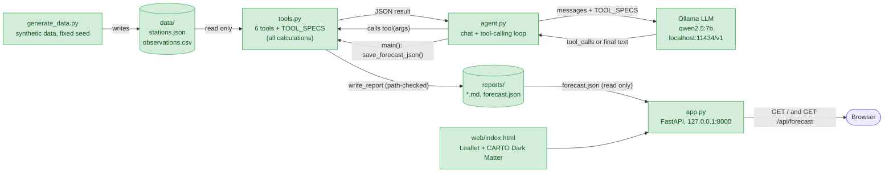
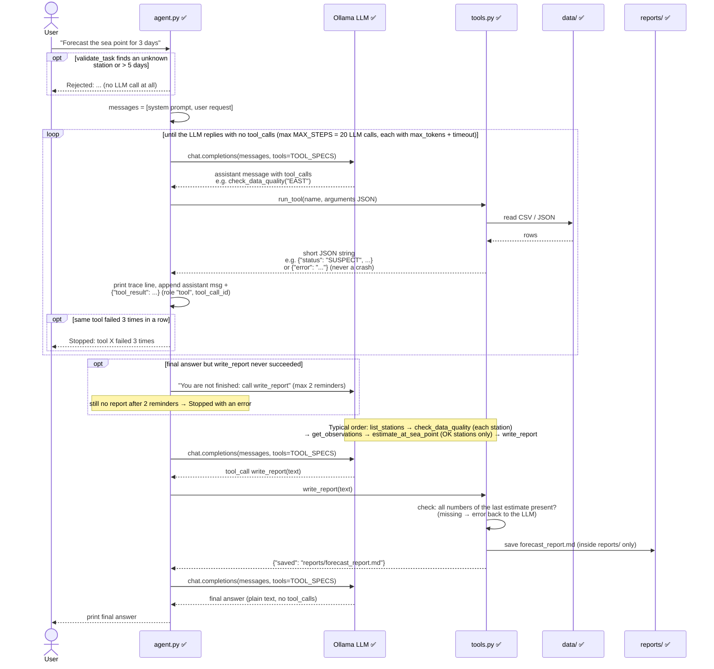

# Architecture

Marine weather agent: four coastal stations around a bay feed a 3-day forecast for one point at sea.
Python tools do every calculation. The local LLM only picks which tools to call and writes the report.

## Progress

| Step | Part | Status |
|------|------|--------|
| 1 | `generate_data.py`: synthetic data in `data/` | ✅ Done |
| 2 | `tools.py`: 6 tools + JSON specs, `test_tools.py` | ✅ Done |
| 3a | `agent.py`: one LLM call, print the raw tool call | ✅ Done |
| 3b | `agent.py`: execute that tool call with `tools.py` | ✅ Done |
| 3c | `agent.py`: full loop, `tool` messages, `MAX_STEPS = 15`, errors go back to the LLM | ✅ Done |
| 3d | `agent.py`: readable trace (tool, args, shortened result) | ✅ Done |
| 3+ | `tools.py`: `estimate_at_sea_point` returns `pressure_trend` + Beaufort `warnings` | ✅ Done |
| 4 | `experiments.py`: 6 "break" scenarios via runtime patching (agent/tools unchanged) | ✅ Done |
| 5 | Guardrails in code: tools refuse SUSPECT stations, error instead of numbers, results wrapped as data, final answer needs a saved report, stop after 3 identical tool failures | ✅ Done |
| 6 | Task validated before the loop; `write_report` checks the report against the last estimate; `experiments.py --runs N` with pass/fail | ✅ Done |
| 7 | `agent.TEMPERATURE` setting; `experiments.py --temperature` | ✅ Done |
| 8 | `MAX_STEPS = 20`; `max_tokens` and a timeout on each LLM call (no silent SDK retries) | ✅ Done |
| 9 | Map: real Kiel Bay coordinates, `reports/forecast.json`, `app.py` (FastAPI, localhost), `web/index.html` (Leaflet) | ✅ Done |

*Last updated: end of step 9 (map).*

`experiments.py` doesn't change the diagrams. It imports `agent.py`, swaps the task, the system prompt
or entries in `agent.TOOL_FUNCTIONS`, and redirects `write_report` to `reports/experiment_<scenario>.md`.

## 1. Components

**Legend:** green = done, grey dashed = not built yet.

Notes:
- The LLM never touches files directly. It writes the report text, and the `write_report` tool saves it.
  So `reports/` is reached only through `tools.py`.
- `tools.py` may only read `data/` and write `reports/`. Paths are checked inside the tools.
- The Ollama model itself isn't part of this repo. It counts as done because `agent.py` now uses it.
- Interpretations such as the pressure trend and wind warnings are worked out in `tools.py`,
  not by the LLM. In an early run the LLM called a rising pressure "falling".
- `reports/forecast.json` is built by `tools.save_forecast_json()` from tool results only (never LLM text).
  `agent.py` calls it in `main()` after a successful run; experiments never write it.
- The map page calculates nothing; it only displays `/api/forecast`. `app.py` binds to 127.0.0.1 only.
- Stations sit on the real Kiel Bay coast (Marstal, Fehmarn, Schönberger Strand, Damp); the weather data is synthetic.

## 2. One agent run (sequence)

**Legend:** ✅ done, ⬜ not built yet.

### Guardrails (in code, not just in the prompt)

| # | Where | What it does |
|---|-------|--------------|
| 1 | `tools.estimate_at_sea_point` | Checks quality itself and drops SUSPECT stations (`stations_excluded`) |
| 2 | `tools.forecast_station`, `estimate_at_sea_point` | SUSPECT station or none reliable left → `{"error": ...}`, never numbers |
| 3 | `agent.wrap_as_data` + system prompt | Tool output is sent as `{"tool": ..., "tool_result": ...}` and declared to be data |
| 4 | `agent.run_agent` | A final answer counts only after `write_report` succeeded; otherwise up to 2 reminders, then stop |
| 5 | `agent.run_agent` | The same tool failing 3 times in a row stops the run |
| 6 | `agent.validate_task` | Unknown station/location or more than 5 days → `Rejected: ...` before any LLM call |
| 7 | `tools.write_report` | Saves only if the text contains every daily number of the last `estimate_at_sea_point` (or says "unavailable" when no forecast was possible) |

Unknown tool names, broken argument JSON and bad arguments all come back to the LLM as
`{"error": ...}` tool results, so the model can correct itself. If no final answer comes
after `MAX_STEPS` LLM calls, the run stops with a message.

The key idea: the LLM never runs code. It only *asks* for a tool call. `agent.py` runs the real function
and sends the JSON result back as a `tool` message. The loop repeats until the LLM answers with plain text.
